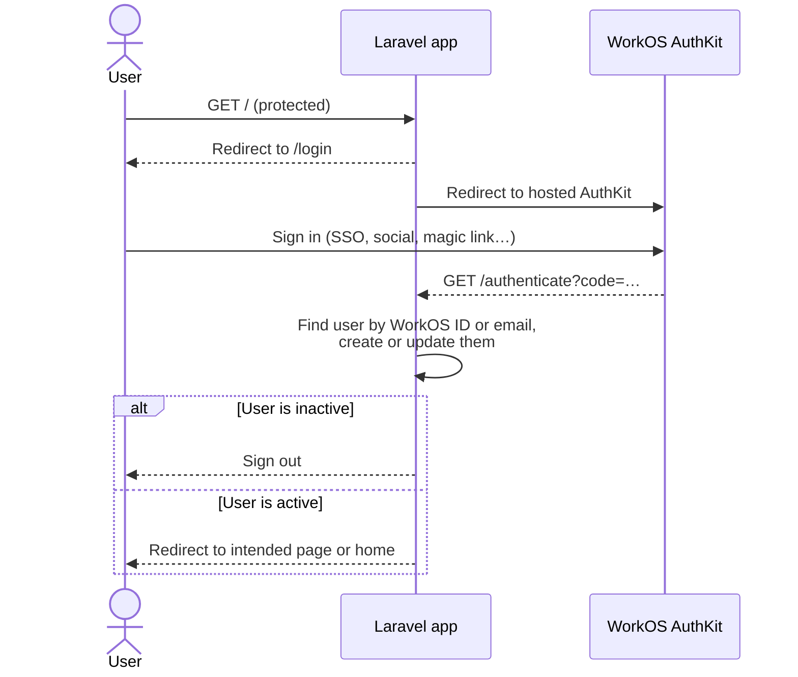
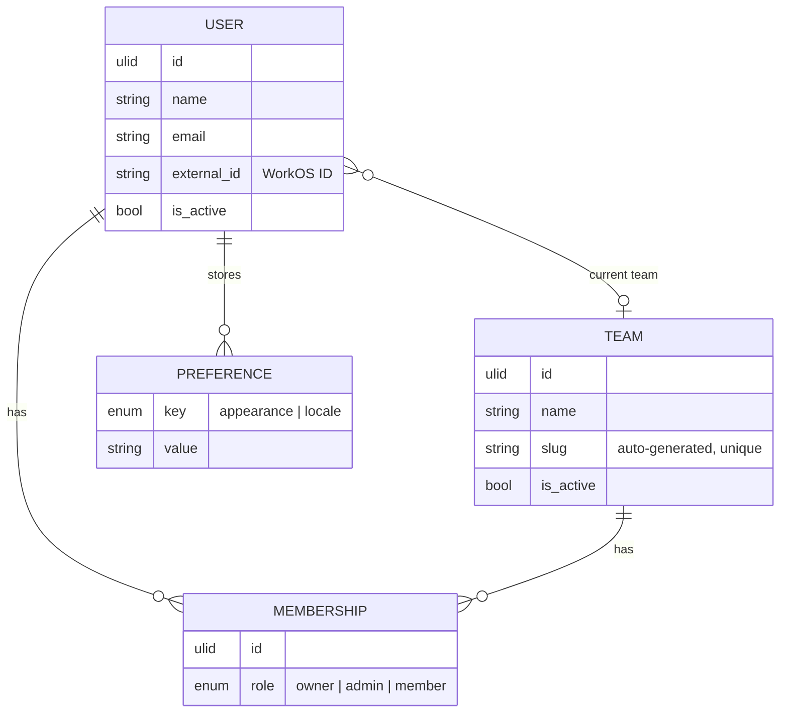

<div align="center">

# 🚀 Laravel React Starter Kit

**An opinionated, production-minded starter kit for building modern SaaS apps with Laravel, Inertia and React.**

Authentication, teams, an admin panel, audit logs, i18n and a strict quality toolchain, all wired up so you can start on the features that matter.

[](https://github.com/scajal/laravel-react-starter-kit/actions/workflows/tests.yml)
[](LICENSE)
[](https://github.com/scajal/laravel-react-starter-kit/generate)


</div>

---

## 📖 Table of contents

- [✨ Features](#-features)
- [🧱 Tech stack](#-tech-stack)
- [🏗️ How it works](#️-how-it-works)
- [⚡ Getting started](#-getting-started)
- [🛠️ Available scripts](#️-available-scripts)
- [🧪 Testing & quality](#-testing--quality)
- [🤖 AI-assisted development](#-ai-assisted-development)
- [📂 Project structure](#-project-structure)
- [🚧 Roadmap](#-roadmap)
- [🤝 Contributing](#-contributing)
- [📄 License](#-license)

---

## ✨ Features

| | Feature | What you get |
|---|---|---|
| 🔐 | **Passwordless-ready auth** | Sign-in handled by [WorkOS AuthKit](https://workos.com/user-management): SSO, social logins, magic links and MFA with no password storage in your app. Inactive users are signed out automatically. |
| 👥 | **Teams & roles** | Users belong to many teams through memberships with `Owner`, `Administrator` and `Member` roles, a current-team switcher and a permission enum ready for your rules. |
| 🛡️ | **Admin panel** | A [Filament 5](https://filamentphp.com) panel at `/administration` to manage users, teams and members, with an SPA feel, deferred tables and unsaved-changes alerts. |
| 📜 | **Audit trail** | Every change to users, teams and memberships is logged with [spatie/laravel-activitylog](https://spatie.be/docs/laravel-activitylog) and shown as a timeline in the admin panel. |
| 🌍 | **Internationalization** | English 🇬🇧 and Spanish 🇪🇸 out of the box, shared between Laravel and React. Only the active language's dictionary is downloaded. |
| 🌗 | **Light / dark / system themes** | The chosen appearance and locale are stored on the user's account and synced through cookies, so there's no flash of the wrong theme and preferences follow users across devices. |
| ⚡ | **SSR & React Compiler** | Server-side rendering through `@inertiajs/vite` and automatic memoization with the React Compiler. |
| 🧭 | **Type-safe routing** | [Wayfinder](https://github.com/laravel/wayfinder) generates TypeScript functions for your Laravel routes and controllers, so you never hardcode URLs again. |
| 🪟 | **Modals as routes** | [Inertia Modal](https://inertiaui.com/inertia-modal) opens any route in a modal or slideover, with deep-linkable URLs. |
| 🎨 | **shadcn/ui ready** | Tailwind CSS 4, Radix UI, Lucide icons and a pre-configured `components.json`. Run `pnpm dlx shadcn add button` and go. |
| 🧰 | **Sensible defaults** | [Essentials](https://github.com/nunomaduro/essentials) turns on strict models, immutable dates, auto eager loading, stray-request prevention and no destructive commands in production. |
| 🆔 | **ULID primary keys** | Non-sequential, sortable IDs on every model. |
| ✅ | **Strict quality gates** | Pest 5, PHPStan level 7, Rector, Pint, Vite+ lint/format and TypeScript checks, all running in GitHub Actions. |

---

## 🧱 Tech stack

**Backend**

- 🐘 [PHP 8.3+](https://www.php.net) & [Laravel 13](https://laravel.com)
- 🔌 [Inertia.js 3](https://inertiajs.com) (server adapter)
- 🛡️ [Filament 5](https://filamentphp.com) with Lucide icons & a language switcher
- 🔐 [Laravel WorkOS](https://github.com/laravel/workos)
- 📜 [spatie/laravel-activitylog](https://github.com/spatie/laravel-activitylog) + [relaticle/activity-log](https://github.com/relaticle/activity-log) timelines
- 🔎 [spatie/laravel-query-builder](https://github.com/spatie/laravel-query-builder)
- 🌍 [Laravel Lang](https://laravel-lang.com)

**Frontend**

- ⚛️ [React 19](https://react.dev) + [React Compiler](https://react.dev/learn/react-compiler)
- 🟦 [TypeScript 7](https://www.typescriptlang.org)
- 🎨 [Tailwind CSS 4](https://tailwindcss.com), [Radix UI](https://www.radix-ui.com) & [shadcn/ui](https://ui.shadcn.com)
- ⚡ [Vite+](https://viteplus.dev) for building, linting and formatting
- 🧭 [Wayfinder](https://github.com/laravel/wayfinder) for typed routes
- 🌐 [laravel-react-i18n](https://github.com/EugeneMeles/laravel-react-i18n)

**Tooling**

- 🧪 [Pest 5](https://pestphp.com) with arch, type-coverage and PHPStan plugins
- 🔬 [Larastan](https://github.com/larastan/larastan) (level 7) & [Rector](https://getrector.com)
- 💅 [Laravel Pint](https://laravel.com/docs/pint)
- 🤖 [Laravel Boost](https://github.com/laravel/boost) MCP server and agent skills
- 🐛 [Laravel Pail](https://github.com/laravel/pail) and IDE Helper

---

## 🏗️ How it works

### 🔐 Authentication flow



Every authenticated route also runs WorkOS session validation, so a session revoked in WorkOS ends in your app too.

### 👥 Identity model



### 🧩 Modular architecture

Code is grouped by **domain module** under `app/Modules` instead of Laravel's default flat layout, so each area of the product keeps its models, HTTP layer, routes and admin resources together:

- **`Authentication`**: WorkOS login, callback and logout.
- **`Core/Identity`**: users, teams, memberships, roles, permissions and preferences.
- **`Core/Audit`**: the activity log model and summaries.
- **`Administration`**: the Filament panel and its resources.
- **`Support`**: shared traits (`HasActivation`, `AsOptions`, `DefinesKeyType`) and the Inertia middleware.

Factories and tests mirror the same structure, so finding the test for any class is predictable.

### 🔄 Shared Inertia props

Every page receives `user`, `locale`, `appearance` and an `authorization` object (admin access plus the current team's permissions) via `HandleInertiaRequests`, fully typed on the React side.

---

## ⚡ Getting started

### 📋 Prerequisites

- **PHP 8.3+** with the SQLite extension
- **Composer 2**
- **Node.js 22+** and **pnpm**
- A free **[WorkOS](https://workos.com)** account

### 1️⃣ Create your project

Click **[Use this template](https://github.com/scajal/laravel-react-starter-kit/generate)** on GitHub, or clone it directly:

```bash
git clone https://github.com/scajal/laravel-react-starter-kit.git my-app
cd my-app
```

### 2️⃣ Install everything

One command installs PHP and JS dependencies, creates `.env`, generates the app key, creates the SQLite database, runs migrations and builds the assets:

```bash
composer setup
```

### 3️⃣ Configure WorkOS

1. In the [WorkOS dashboard](https://dashboard.workos.com), open **Authentication → AuthKit** and enable it.
2. Under **Redirects**, set:
   - **Redirect URI**: `http://localhost:8000/authenticate`
   - **Sign-in endpoint**: `http://localhost:8000/login`
   - **Sign-out redirect**: `http://localhost:8000`
3. Copy your **Client ID** and **API key** into `.env`:

```dotenv
WORKOS_CLIENT_ID=client_...
WORKOS_API_KEY=sk_test_...
WORKOS_REDIRECT_URL="${APP_URL}/authenticate"
```

### 4️⃣ Start developing

```bash
composer dev
```

This starts the web server, the queue worker, the log tail (Pail) and Vite in one terminal. Open **http://localhost:8000**, sign in through AuthKit and you're in! 🎉

> [!TIP]
> The admin panel lives at **http://localhost:8000/administration**. Out of the box, access is granted to any signed-in user **in the local environment only**. Update `User::canAccessPanel()` with your own rule before deploying.

### 🗄️ Using another database

SQLite is the default for zero-config local development. To switch to MySQL or PostgreSQL, update the `DB_*` variables in `.env` and run `php artisan migrate`.

---

## 🛠️ Available scripts

| Command | Description |
|---|---|
| `composer setup` | 📦 Install dependencies and bootstrap the app from scratch |
| `composer dev` | 🔥 Run server, queue, logs and Vite together |
| `composer test` | 🧪 Lint checks + the full Pest suite in parallel |
| `composer test:coverage` | 📊 Run tests with a **100% code coverage** gate |
| `composer test:types` | 🔠 Run tests with a **100% type coverage** gate |
| `composer lint` | 🧹 Apply Rector and Pint fixes, then run PHPStan |
| `composer lint:check` | 🔍 Same checks without writing changes |
| `composer ci:check` | 🚦 Everything CI runs: JS lint/format, TS types and tests |
| `pnpm run dev` | ⚡ Vite dev server only |
| `pnpm run build` | 🏗️ Production build |
| `pnpm run build:ssr` | 🖥️ Production build with the SSR bundle |
| `pnpm run check` / `check:fix` | 💅 Lint and format the frontend with Vite+ |
| `pnpm run types:check` | 🟦 Type-check TypeScript |

---

## 🧪 Testing & quality

The kit treats quality as a feature:

- ✅ **Pest 5** feature and unit tests for every module
- 🔬 **PHPStan level 7** via Larastan across `app`, `config`, `database` and `routes`
- ♻️ **Rector** for automated refactors and modern PHP syntax
- 💅 **Pint** for consistent PHP style
- 🧹 **Vite+** linting with type-aware rules (warnings fail the build) and formatting with sorted imports and Tailwind classes
- 🚦 **GitHub Actions** runs the whole pipeline on every push and pull request
- 🤖 **Dependabot** keeps dependencies fresh

```bash
composer test
```

---

## 🤖 AI-assisted development

This repository is built to work great with AI coding agents:

- 🧠 **[Laravel Boost](https://github.com/laravel/boost)** MCP server (`.mcp.json`) gives agents access to your schema, logs, routes and version-specific docs.
- 📘 **`AGENTS.md`** carries the project's conventions for any agent.
- 🧩 **Agent skills** for Claude Code, Cursor and Codex cover Inertia React, Filament, Wayfinder, Tailwind, Pest, activity logging and more.

Open the project in your favourite agent and it already knows how the codebase is meant to be written.

---

## 📂 Project structure

```text
app/Modules/
├── Administration/        # Filament panel, resources, relation managers
├── Authentication/        # WorkOS login, callback & logout
├── Core/
│   ├── Audit/             # Activity log model & summaries
│   └── Identity/          # Users, teams, memberships, roles, preferences
└── Support/               # Shared concerns & Inertia middleware
database/
├── factories/Modules/     # Factories mirroring app/Modules
└── migrations/
lang/                      # en & es translations (PHP + JSON)
resources/
├── css/                   # App and admin panel themes
├── js/
│   ├── pages/             # Inertia React pages
│   ├── lib/               # i18n & utilities
│   └── types/             # Shared prop typings
└── views/                 # Root Blade template
tests/
├── Feature/Modules/       # Feature tests mirroring app/Modules
└── Unit/Modules/          # Unit tests mirroring app/Modules
```

---

## 🚧 Roadmap

> [!NOTE]
> This kit is under active development. The foundations (auth, teams, admin panel, audit log, i18n, theming and tooling) are in place, while a few user-facing pieces are still on the way.

- [ ] 🏠 **Home page**: replace the placeholder `welcome` page with a real dashboard.
- [ ] 🔔 **Flash toasts**: show server flash messages with shadcn's toast component.
- [ ] 👥 **Team onboarding**: send users who belong to no team to a team-creation page after signing in.
- [ ] 🔑 **Team permissions**: the `Permission` enum ships empty, ready for you to declare the actions your roles grant.

---

## 🤝 Contributing

Contributions, issues and ideas are welcome! 💡

1. Fork the repository
2. Create a branch: `git checkout -b feature/amazing-thing`
3. Make sure everything passes: `composer ci:check`
4. Open a pull request 🚀

If this kit saved you some time, consider giving it a ⭐ on GitHub. It really helps!

---

## 📄 License

Released under the [MIT License](LICENSE).

<div align="center">

Made with ❤️ by [Santiago Cajal](https://github.com/scajal)

</div>
